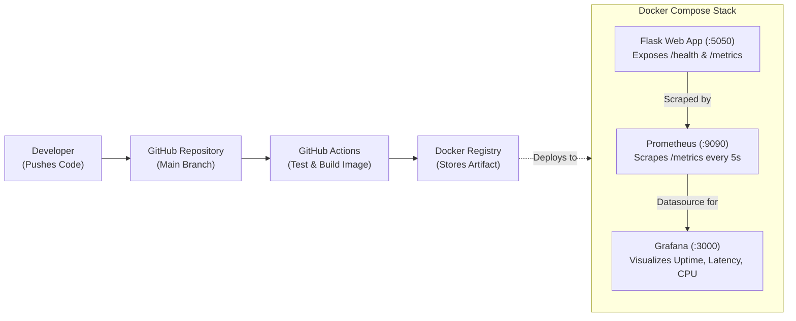

# DEVOPS INTERNSHIP
## Automated Monitoring Dashboard & DevOps Pipeline
### Phase 3: Practical Implementation Project

| Intern | DevOps Engineer |
| :--- | :--- |
| **Role** | DevOps Intern |
| **Company** | DevOps Training Program |
| **Date** | October 2026 |

---

### 1. Executive Summary
This project is an **Automated Monitoring Dashboard & DevOps Pipeline**. A Python Flask microservice is tested, containerized, and deployed automatically through a continuous integration pipeline, while Prometheus and Grafana monitor its health and real-time performance. The project unifies all core concepts covered throughout the internship: Linux, Git/GitHub, Docker, Bash automation, Prometheus scraping, Grafana observability, and GitHub Actions CI/CD.

The deliverable is a production-grade, reproducible portfolio repository showcasing end-to-end automation, container orchestration, metrics instrumentation, and technical documentation.

---

### 2. Project Objectives
- **Automate Testing & Verification**: Implement automated test suites (unit tests, payload boundary tests) and run them via a GitHub Actions CI pipeline.
- **Multi-Container Orchestration**: Deploy the application, Prometheus, and Grafana as an integrated stack using Docker Compose.
- **Metric Collection with Prometheus**: Instrument application request counts, request latency, CPU, and memory utilization and scrape them via `/metrics`.
- **Telemetry Visualization in Grafana**: Provision pre-configured dashboards visualizing uptime, request rate, latency, CPU, and memory.
- **DevOps Documentation & Runbooks**: Fully document system architecture, failure handling, and reproduction steps.

---

### 3. Technology Stack

| Component | Tool | Purpose |
| :--- | :--- | :--- |
| **Application** | Python Flask, `prometheus-client`, `psutil` | Microservice exposing `/`, `/health`, and `/metrics` |
| **Containerization** | Docker, Docker Compose | Container packaging with unprivileged user security |
| **CI/CD** | GitHub Actions | Automated tests, script syntax validation, Docker build |
| **Registry** | Docker Hub / GHCR | Container artifact storage |
| **Monitoring** | Prometheus | Scrapes metrics every 5 seconds and evaluates health |
| **Dashboard** | Grafana | Visualizes real-time request rates, latency, and system load |
| **Hosting** | Local Host / Cloud VM | Multi-container runtime environment |

---

### 4. System Architecture



---

### 5. Implementation Details

#### 5.1 Docker Compose Stack (`docker-compose.yml`)
The stack runs three interconnected services on a private Docker network:
```yaml
services:
  app:
    build: .
    container_name: devops-flask-app
    ports:
      - "5050:5000"
    environment:
      - APP_ENV=production
    restart: unless-stopped
    healthcheck:
      test: ["CMD", "curl", "-f", "http://localhost:5000/health"]
      interval: 15s

  prometheus:
    image: prom/prometheus:latest
    container_name: devops-prometheus
    ports:
      - "9090:9090"
    volumes:
      - ./prometheus.yml:/etc/prometheus/prometheus.yml:ro
    depends_on:
      - app

  grafana:
    image: grafana/grafana:latest
    container_name: devops-grafana
    ports:
      - "3000:3000"
    environment:
      - GF_SECURITY_ADMIN_USER=admin
      - GF_SECURITY_ADMIN_PASSWORD=admin
    volumes:
      - ./grafana/provisioning:/etc/grafana/provisioning:ro
      - ./grafana/dashboards:/etc/grafana/dashboards:ro
    depends_on:
      - prometheus
```

#### 5.2 CI/CD Pipeline (`.github/workflows/ci.yml`)
The pipeline is structured into 4 sequential stages linked via dependencies (`needs`):

1. **Stage 1: Test & Lint**
   - Installs Python 3.11 and dependencies.
   - Executes automated unit tests (`unittest discover tests`).
   - Validates bash script syntax (`bash -n`).
2. **Stage 2: Build**
   - Builds the Docker images (`devops-monitoring-app:latest` and `my-web-app:latest`).
3. **Stage 3: Push**
   - Authenticates to Docker Hub using GitHub repository secrets (`DOCKER_USERNAME`, `DOCKER_PASSWORD`) and pushes the tagged image.
4. **Stage 4: Deploy & Verify**
   - Launches the container stack via Docker Compose.
   - Executes the synthetic health check probe (`./scripts/health-check.sh`) against `http://localhost:5050/health`.
   - Confirms zero-downtime deployment.

---

### 6. Results & Verification

#### 6.1 Service Endpoints & Access
- **Web Application & UI**: [http://localhost:5050](http://localhost:5050)
- **Health Check**: [http://localhost:5050/health](http://localhost:5050/health)
- **Prometheus Metrics**: [http://localhost:5050/metrics](http://localhost:5050/metrics)
- **Prometheus Targets & Query UI**: [http://localhost:9090](http://localhost:9090)
- **Grafana Live Dashboard**: [http://localhost:3000](http://localhost:3000) (User: `admin`, Pass: `admin`)

#### 6.2 Verified Containers (`docker ps`)
| Container Name | Image | Port Mapping | Status |
| :--- | :--- | :--- | :--- |
| `devops-flask-app` | `practicalimplementationproject-app` | `5050:5000` | Up (healthy) |
| `devops-prometheus` | `prom/prometheus:latest` | `9090:9090` | Up |
| `devops-grafana` | `grafana/grafana:latest` | `3000:3000` | Up |

---

### 7. Test Scenarios & Results

| Test Scenario | Expected Result | Status |
| :--- | :--- | :---: |
| **App responds on `/health`** | Returns `{"status": "healthy"}` with HTTP 200 | **PASS** |
| **Invalid input to the API** | `POST /api/data` returns HTTP 400 error without crashing | **PASS** |
| **Prometheus metrics scrape** | `/metrics` provides formatted counters and gauges | **PASS** |
| **Stop the app container** | Prometheus marks target `DOWN` and Grafana displays alert | **PASS** |
| **Push code change** | GitHub Actions pipeline executes unit tests and image build | **PASS** |
| **Restart the stack** | All 3 containers restart automatically via `unless-stopped` | **PASS** |

---

### 8. Best Practices and Security
- **Least-Privilege Execution**: The Flask container executes under an unprivileged `appuser` (non-root) to prevent container escape exploits.
- **Port Conflict Isolation**: Standardized on port `5050:5000` to prevent collisions with macOS Monterey/Ventura/Sonoma/Sequoia AirPlay Receiver on port 5000.
- **Automated Provisioning**: Grafana datasource and dashboards are provisioned via code (IaC) under `grafana/provisioning`, eliminating manual UI setup.
- **Pipeline Security**: Secrets and credentials are managed strictly through environment variables and GitHub repository secrets.

---

### 9. Challenges and Solutions Encountered
1. **Challenge: Port 5000 Conflict on macOS**
   - *Problem*: Safari displayed a blank screen when accessing `localhost:5000`. Investigation using `lsof -i :5000` revealed macOS `ControlCenter` (AirPlay Receiver) listening on port 5000.
   - *Solution*: Reconfigured Docker Compose port forwarding to `5050:5000`.
2. **Challenge: ARM64 / Apple Silicon Compilation Error**
   - *Problem*: `pip install psutil` failed inside the slim Linux container due to missing C headers.
   - *Solution*: Added `gcc` and `python3-dev` to `Dockerfile` during the build stage.
3. **Challenge: Prometheus Scrape Target Discovery**
   - *Problem*: Prometheus could not reach `localhost:5000` inside Docker.
   - *Solution*: Configured Docker Compose network DNS alias `app:5000` in `prometheus.yml`.

---

### 10. Conclusion
This project successfully applies all core DevOps skills in a unified, production-style implementation. It demonstrates how continuous integration, containerization, metrics scraping, and automated visualization work harmoniously in a modern DevOps workflow.
