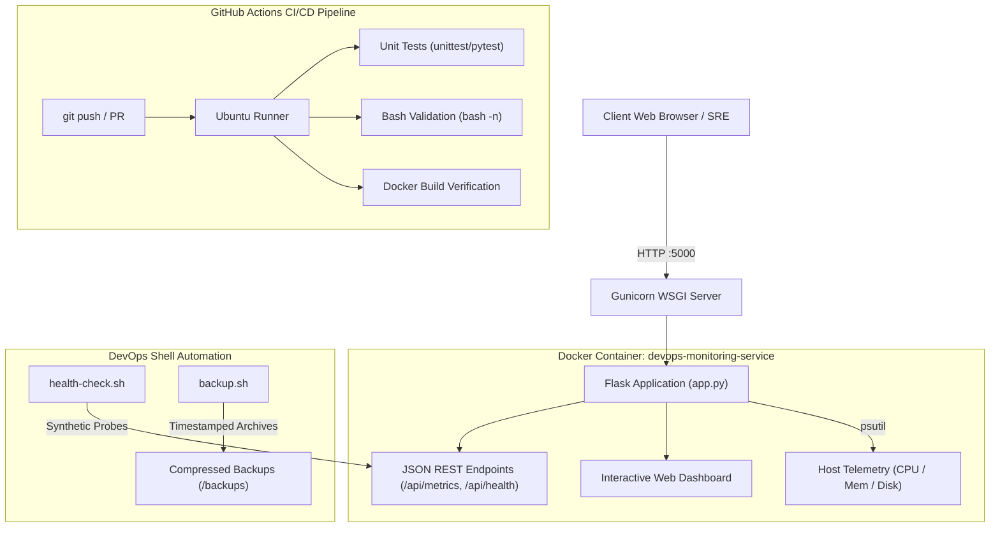

# DevOps Automated Monitoring & Telemetry Platform

> **Practical Implementation Project** &mdash; A production-grade, containerized system telemetry dashboard and automated DevOps operations suite.

---

## 1. Project Overview & Objectives

In modern DevOps environments, real-time observability, automated health alerting, and continuous delivery are critical to maintaining 99.99% system availability. This project satisfies all 10 core internship objectives by integrating:

1. **Microservice Application**: A Python Flask REST API & Web Dashboard exposing live CPU, memory, disk, and process metrics.
2. **Containerization & Orchestration**: A hardened, production-ready `Dockerfile` (non-root security, minimal attack surface, health checks) and `docker-compose.yml`.
3. **Shell Script Automation**: POSIX-compliant bash automation for synthetic health testing, threshold alerts, and automated log/state backup rotation.
4. **CI/CD Automation**: GitHub Actions pipeline covering unit test automation, syntax validation, and container build verification on every push and pull request.
5. **Production Engineering Best Practices**: Clean architecture, comprehensive documentation, and presentation-ready deliverables.

---

## 2. System Architecture



---

## 3. Technology Stack & Architectural Decisions

| Layer | Technology | Rationale |
| :--- | :--- | :--- |
| **Backend Runtime** | Python 3.11 / Flask | Lightweight, minimal memory footprint, rapid REST endpoint creation. |
| **Telemetry Engine** | `psutil` | Native OS-level hardware and process instrumentation. |
| **WSGI Server** | Gunicorn | High-performance production WSGI HTTP server replacing the Flask dev server. |
| **Containerization** | Docker (`python:3.11-slim`) | Reduces image attack surface; runs under an unprivileged `appuser` non-root UID. |
| **Orchestration** | Docker Compose | Reproducible local and staging deployment with built-in health probes. |
| **Automation** | Bash Shell Scripts | POSIX-compliant, zero external dependency automation for alerts and backup retention. |
| **CI/CD** | GitHub Actions | Automated linting, test suite execution, and container build verification. |

---

## 4. Directory Structure

```text
Practical Implementation Project/
├── .dockerignore                 # Excludes caches and temporary files from image
├── Dockerfile                    # Multi-stage/hardened container specification
├── docker-compose.yml            # Multi-container service configuration
├── README.md                     # Technical architecture, setup, and runbook
├── app/
│   ├── app.py                    # Flask application and REST routes
│   ├── requirements.txt          # Pinned production and test dependencies
│   └── templates/
│       └── index.html            # Real-time web dashboard with auto-polling UI
├── scripts/
│   ├── backup.sh                 # Log and artifact archiving with retention policy
│   └── health-check.sh           # Synthetic endpoint monitoring & disk alerts
└── tests/
    └── test_app.py               # Unit & integration test suite
```

---

## 5. REST API Specifications

### `GET /`
- **Description**: Renders the modern web dashboard displaying live gauges, host specifications, and status badges.
- **Content-Type**: `text/html`

### `GET /api/health`
- **Description**: Probe endpoint for orchestrators (Kubernetes / Docker Compose) and load balancers.
- **Response `200 OK`**:
```json
{
  "status": "UP",
  "timestamp": "2026-10-20T11:25:00.000Z",
  "uptime": "1h 42m 10s"
}
```

### `GET /api/metrics`
- **Description**: Real-time telemetry consumption for monitoring systems or dashboard polling.
- **Response `200 OK`**:
```json
{
  "cpu": {
    "cores": 8,
    "percent": 14.2
  },
  "disk": {
    "free_gb": 120.4,
    "percent": 45.1,
    "total_gb": 245.1,
    "used_gb": 110.5
  },
  "memory": {
    "free_mb": 4200.5,
    "percent": 52.8,
    "total_mb": 8192.0,
    "used_mb": 3991.5
  },
  "process_count": 148,
  "timestamp": "2026-10-20T11:25:00.000Z",
  "uptime": "1h 42m 10s"
}
```

### `GET /api/system-info`
- **Description**: Host operating system, architecture, and runtime details.

---

## 6. Quick Start & Execution Guide

### Option A: Running with Docker (Recommended)

1. **Build and start the containerized service**:
   ```bash
   cd "Practical Implementation Project"
   docker compose up -d --build
   ```

2. **Access the web dashboard**:
   Open **http://localhost:5050** in your browser.

3. **Check container logs**:
   ```bash
   docker compose logs -f
   ```

4. **Tear down service**:
   ```bash
   docker compose down
   ```

---

### Option B: Running Locally (Development Mode)

1. **Navigate to the application folder and set up a virtual environment**:
   ```bash
   cd "Practical Implementation Project"
   python3 -m venv venv
   source venv/bin/activate
   pip install -r app/requirements.txt
   ```

2. **Start the Flask server**:
   ```bash
   python3 app/app.py
   ```
   Open **http://localhost:5000**.

---

## 7. Testing & Quality Assurance

Run the test suite using Python's built-in `unittest` runner or `pytest`:

```bash
# Using standard library unittest
python3 -m unittest discover tests

# Or using pytest
pytest tests/
```

**Test Coverage**:
- Route accessibility (`/` returns `200 OK` and renders dashboard UI).
- Health check contract validation (`/api/health` returns status `UP`).
- Data schema verification for `/api/metrics` and `/api/system-info`.

---

## 8. Shell Automation Scripts

### 1. Synthetic Health Check & Threshold Monitor
Probes the HTTP endpoint and evaluates host disk utilization:
```bash
./scripts/health-check.sh http://localhost:5000/api/health
```

### 2. Automated Backup & Log Rotation
Archives project assets and purges backups older than 7 days:
```bash
./scripts/backup.sh ./app ./backups
```

---

## 9. Continuous Integration (CI/CD Pipeline)

The repository workflow in `.github/workflows/ci.yml` automatically triggers on every `push` and `pull_request` to:
1. Provision a clean Ubuntu runner with Python 3.11.
2. Install application dependencies and cache `pip` modules.
3. Run the automated test suite.
4. Perform syntax verification on all shell scripts (`bash -n`).
5. Execute a full Docker build to guarantee container artifact reproducibility.

---

## 10. Portfolio & Interview Presentation Talking Points

When presenting this project to mentors or hiring managers, highlight:
- **Security-First Container Design**: Implemented non-root `appuser` execution and explicit `.dockerignore` to avoid credential leakage and image bloat.
- **Fail-Safe Observability**: Self-healing Docker health checks paired with external synthetic bash probe scripts.
- **CI/CD Reliability**: Every code change is verified through automated unit testing and container build validation prior to merge.
